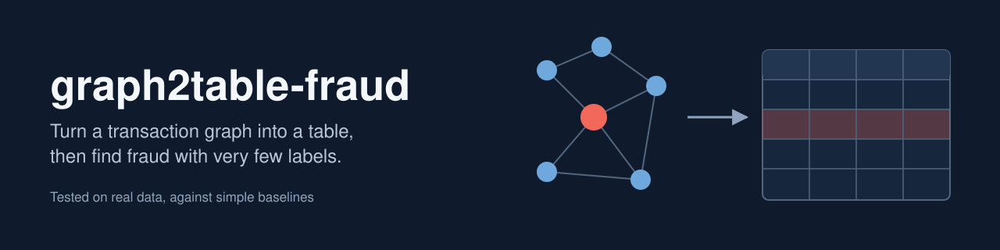
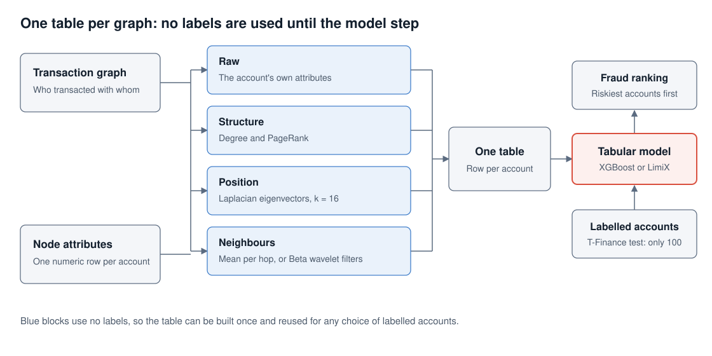
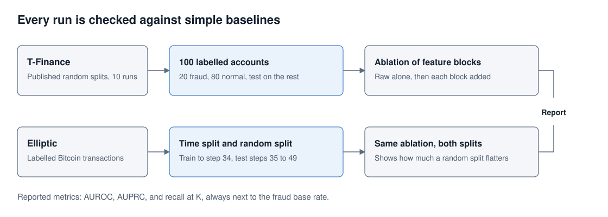

# graph2table-fraud

Find fraud in a transaction graph by turning it into an ordinary table, then using a tabular model. This repo is an independent implementation with measured results on two datasets, always next to simple baselines.

**Main results**

- With only 100 labelled accounts on T-Finance, XGBoost on the flattened table reaches AUPRC 81.84%, against 71.61% on raw features. The pretrained LimiX-16M model reaches 84.75%.
- On Elliptic, a split by time gives AUPRC 80.78%, while a random split on the same features gives 98.84%. A random split badly overstates performance here.

## How it works



Each account gets one row, built from four blocks. None of them use labels.

| Block | Columns | What it captures |
| --- | --- | --- |
| Raw | The account's attributes | What the account looks like |
| Structure | Degree, PageRank | How connected it is |
| Position | 16 Laplacian eigenvectors | Where it sits in the whole graph |
| Neighbours | Mean per hop, or Beta wavelet filters | What its counterparties look like |

## Results



### T-Finance

100 labelled accounts (20 fraud, 80 normal), 10 published random splits, tested on the other 39,257 accounts. Fraud rate in the test set is about 4.5%. Values are mean ± std in percent.

| Model and features | AUROC | AUPRC | Recall at K |
| --- | --- | --- | --- |
| LimiX-16M, original TFM4GAD code | 95.90 ± 0.41 | 84.75 ± 1.69 | 78.66 ± 2.21 |
| LimiX-2M, original TFM4GAD code | 95.65 ± 0.41 | 83.45 ± 2.61 | 77.03 ± 3.41 |
| XGBoost, raw + position | 95.89 ± 0.41 | 83.23 ± 2.10 | 76.70 ± 2.41 |
| XGBoost, all blocks, neighbour means | 95.56 ± 0.43 | 81.84 ± 2.22 | 75.14 ± 2.15 |
| XGBoost, all blocks, wavelets | 95.56 ± 0.52 | 81.60 ± 3.30 | 74.91 ± 3.36 |
| XGBoost, raw + neighbour means | 95.05 ± 0.50 | 79.80 ± 2.19 | 73.28 ± 2.23 |
| XGBoost, raw + structure | 93.81 ± 1.04 | 75.99 ± 2.67 | 70.52 ± 2.51 |
| XGBoost, raw only | 92.84 ± 1.17 | 71.61 ± 2.75 | 68.15 ± 1.44 |

The differences among the top rows are about the size of one standard deviation, so treat them as close. Raw + position was picked out after seeing these test numbers, so it needs a fresh check before anyone relies on it.

Our implementation lines up with the original code's features: XGBoost with the same fixed settings scored AUROC 95.37 and AUPRC 81.70 on the table from the original code ([log](results/upstream_baselines_tfinance.json)).

### Elliptic

46,564 labelled Bitcoin transactions. Train on 29,894 up to time step 34, test on 16,670 from steps 35 to 49, where the fraud rate is 6.5%. The random split uses the same training size. XGBoost, 5 seeds.

| Features | AUPRC, time split | AUPRC, random split | AUROC, time split |
| --- | --- | --- | --- |
| Raw + neighbour means | 80.78 ± 0.26 | 98.84 ± 0.17 | 93.81 ± 0.18 |
| Raw + structure + neighbour means | 80.76 ± 0.12 | 98.85 ± 0.19 | 93.84 ± 0.09 |
| Raw + structure | 79.97 ± 0.21 | 98.86 ± 0.17 | 93.02 ± 0.35 |
| Raw only | 79.94 ± 0.11 | 98.85 ± 0.17 | 92.87 ± 0.16 |

Graph blocks add under 1 AUPRC point here, because Elliptic's 165 features already include neighbour summaries. Position columns are left out because Elliptic's time steps are not connected to each other.

## Limits

- **T-Finance's origin is unverified.** Its provider is undisclosed, its features are anonymised, and its anomaly label also covers online gambling.
- **Elliptic is crypto, not bank data,** and its labels are partly heuristic.
- **Features use the whole graph, including test accounts.** No test labels are used, but a live system would have to rebuild them as new accounts arrive.
- **LimiX was run on T-Finance only,** so we have no LimiX number under a time split.
- **TabPFN did not run** in our environment, so the published TabPFN numbers are untested here.

## Run it

```bash
pip install -r requirements.txt
python tests_features.py   # fast checks, no data needed
python scripts/run_tfinance.py --graph path/to/tfinance --out results/tfinance.json
python scripts/run_elliptic.py --data path/to/elliptic_bitcoin_dataset --out results/elliptic.json
```

To run everything on Kaggle on CPU: `python kaggle/make_notebook.py <kaggle-username>`, then `kaggle kernels push -p kaggle/build`. No tokens are needed.

Data is not included. Get T-Finance from the [GADBench](https://github.com/squareRoot3/GADBench) download and Elliptic from [Kaggle](https://www.kaggle.com/datasets/ellipticco/elliptic-data-set).

To reproduce the LimiX rows, run [`kaggle/reproduce_upstream.sh`](kaggle/reproduce_upstream.sh) in a Kaggle GPU kernel. It fetches the original code at the commits we tested.

## Repo layout

```text
graph2table/    feature code and metrics
scripts/        one script per dataset
kaggle/         kernel builder and the original-code reproduction script
results/        measured numbers and logs behind the tables above
assets/         banner and diagrams
```

## Credit

The method comes from Liu et al., [Tabular Foundation Models are Strong Graph Anomaly Detectors](https://arxiv.org/abs/2601.17301), WWW 2026 ([original code](https://github.com/Cloudy1225/TFM4GAD)). That repo has no licence, so none of its code is copied here. The code in this repo was written from the paper's description. The wavelet filters come from Tang et al., Rethinking Graph Neural Networks for Anomaly Detection (BWGNN), ICML 2022. T-Finance and its splits come through GADBench.

Licence: [MIT](LICENSE), for the code in this repo only. Datasets and model weights keep their own terms: Elliptic is CC BY-NC-ND 4.0, and the LimiX weights are for academic research.
